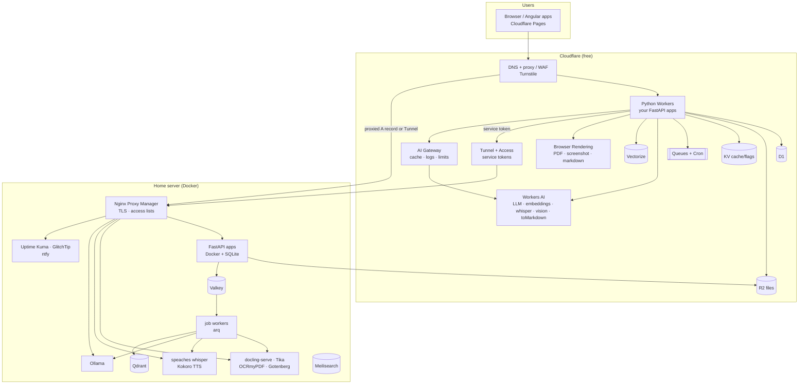
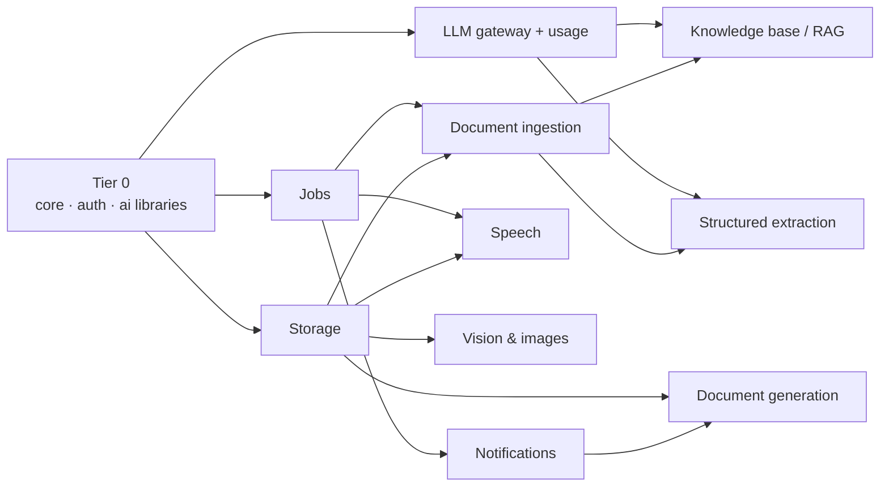
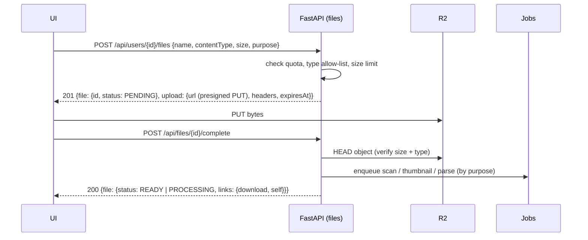
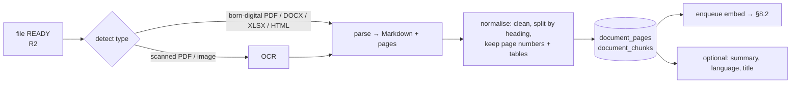

# Reusable services catalogue

A plan for the shared services and libraries worth building once and reusing in every
FastAPI app (and the Angular apps that call them). Each one runs on **Cloudflare's free
tier**, on the **home server behind Nginx Proxy Manager (NPM)**, or on both through the
same interface.

Read [`PYTHON_APP_CONVENTIONS.md`](PYTHON_APP_CONVENTIONS.md) first. Everything here follows
it: portable first, protocol + adapters, router → service → repository, the
`wiltech-labs-rest` envelope, port `8001` locally.

> **Free-tier numbers drift.** The limits quoted below are from mid-2026. Check
> `developers.cloudflare.com/<product>/platform/pricing/` before you design around one.

---

## Contents

1. [What you already have](#1-what-you-already-have)
2. [Design rules for every service](#2-design-rules-for-every-service)
3. [Where things run: Cloudflare + home server + NPM](#3-where-things-run-cloudflare--home-server--npm)
4. [Free resources cheat sheet](#4-free-resources-cheat-sheet)
5. [Build order](#5-build-order)
6. [Tier 0 — extract what you already have into libraries](#6-tier-0--extract-what-you-already-have)
7. [Tier 1 — platform services that unlock the rest](#7-tier-1--platform-services-that-unlock-the-rest)
8. [Tier 2 — documents and AI](#8-tier-2--documents-and-ai)
9. [Tier 3 — smaller cross-cutting services](#9-tier-3--smaller-cross-cutting-services)
10. [What each existing app gains](#10-what-each-existing-app-gains)
11. [Not worth building](#11-not-worth-building)

---

## 1. What you already have

| Capability | Where it lives today | Reuse level | Notes |
|---|---|---|---|
| Response envelope, links, metadata | `wiltech-labs-rest` (PyPI) | **Library** ✅ | The model for every library below |
| Runtime config (Worker env / `.env` / OS env) | `core/config/config.py` | Copy-paste | Identical in every project |
| `Database` protocol: SQLite / D1 binding / D1 HTTP + migrations | `core/config/database.py` | Copy-paste, **drifting** | The template and `fastapi-ai` copies already differ |
| Clerk JWT auth (JWKS cache, `AuthenticatedUser`) | `core/security/auth.py` | Copy-paste, **drifting** | Also differs between the template and `fastapi-ai` |
| Authorization: `get_caller`, `require_owner`, `require_admin`, roles | `core/security/authorization.py`, `roles.py` | Copy-paste | Reads `user_detail_view` |
| Error hierarchy → HTTP (`AppError`, `UpstreamError`, `NotConfiguredError`…) | `core/common/errors.py` | Copy-paste | |
| `AI` protocol: Workers AI binding / REST, Groq | `core/ai/ai.py` | Copy-paste | |
| OpenAI-compatible chat + tool calling over plain `httpx` | `core/ai/llm.py` | Copy-paste | Also works with **Ollama**, unchanged |
| Embeddings (`bge-base-en-v1.5`, batched) | `core/ai/embeddings.py` | Copy-paste | English-only model (see §8.2) |
| `VectorStore` protocol + DB brute-force cosine | `core/ai/vector_store.py`, `resource_vector_store.py` | App-specific | Shaped around chat messages |
| "Ask your data" tool loop (`AssistantService`, `Tool`) | `assistant/` | App-specific | Generic loop, app-specific tools |
| Hybrid search (embeddings + keyword) | `chats/chat_search_service.py`, `todos/todo_search_service.py`, `posts/post_search_service.py` | Repeated per domain | Three copies of the same idea |
| Third-party media (Unsplash, Giphy, YouTube) | `media/media_providers.py` | App-specific | References only, **no uploads** |
| Region / system / user settings, configuration settings | `shared/settings/…`, `users/settings/` | Copy-paste + Angular lib | `SupportedLanguages`: en-GB, en-US, el-CY, pt-BR |
| Engagement analytics | `admin/analytics/` | App-specific | |
| Health / status | `metrics/status_router.py` | Copy-paste | |
| Angular: auth, API client, region settings | `@wiltech-labs/ngx-*` | **Library** ✅ | |

**Missing so far:** file uploads/storage, background jobs, notifications, document
parsing, rate limits and usage quotas, an audit log, caching. Most of the AI ideas
below depend on the first three.

---

## 2. Design rules for every service

### 2.1 Protocol + adapters, always

You already do this for `Database`, `AI` and `VectorStore`. Every new capability gets:

```python
class Thing(Protocol):          # what services depend on
    async def do(self, ...) -> ...: ...

class CloudflareThing: ...      # binding or REST, free tier
class HomeThing: ...            # HTTP call to a container behind NPM
class FakeThing: ...            # in-memory, for tests (or an httpx.MockTransport)

def get_thing(request: Request) -> Thing:   # chooses an adapter from config (THING_MODE)
    ...
```

`get_thing` follows the rule `get_ai` and `get_database` already use: use the native
binding inside a Worker, otherwise HTTP, and let a `*_MODE` env var override either.

### 2.2 Library or standalone service?

| Choose a **library** (pip package, runs inside each app) when… | Choose a **standalone service** (one deployment, called over HTTP) when… |
|---|---|
| It's light and pure Python (it must run in a Python Worker, which uses Pyodide) | It needs native or heavy dependencies (torch, Tesseract, LibreOffice, Chromium, ffmpeg) |
| It's cross-cutting plumbing (auth, db, config, errors, envelopes) | It's slow (> a few seconds) or needs a GPU or lots of RAM |
| Every app needs its own copy of the data | It holds shared state (a job queue, a model server, a search index) |

In practice the **client** half (the Protocol, adapters and DTOs) is always a library, for
example `wiltech-labs-docs`. The **engine** half is either a Cloudflare product or a home
container. Apps never call a third-party API directly; they call your protocol.

### 2.3 Python Worker constraints that decide where code runs

- **Free Workers get 10 ms of CPU per request.** Time spent waiting on the network doesn't
  count, so calling Workers AI, R2 or a home service is fine. Parsing a PDF in-process
  with `pypdf` is not. Heavy work goes to Cloudflare products or home containers.
- Only pure-Python or Pyodide-built packages load. Your existing reason for avoiding the
  `openai` package (about 1.4 s of cold-start CPU) applies to every SDK, so keep using
  plain `httpx`.
- Long jobs don't fit a single request, so use a queue (§7.2).

### 2.4 Service-to-service auth

User calls stay on Clerk JWTs. When an app (a Worker, or a container at home) calls a
shared service:

1. **Service API keys** (simplest): the `X-Api-Key` header holds a key whose SHA-256 hash is
   stored in the service's `api_keys` table, with a name, scopes and `last_used_at`. Rotate
   one by issuing a second key and deleting the first. This lives in `wiltech-labs-auth`
   (§6.2).
2. **Cloudflare Access service tokens** when the home service is published through a
   Cloudflare Tunnel: Access checks `CF-Access-Client-Id` / `CF-Access-Client-Secret` at the
   edge, so unauthenticated traffic never reaches your house.
3. Use both for anything that costs money or CPU (LLMs, OCR, transcription).

### 2.5 Shared conventions for the service APIs

- Long work returns `202 Accepted` with a **job** resource (`/api/jobs/{id}`, see §7.2). The
  client polls it or gets a webhook. Never hold a request open past ~90 s: **Cloudflare's
  proxy cuts requests at 100 s (error 524)**.
- Every row has `owner_user_id` (or `app_id` + `owner_user_id` for shared services), and
  every query filters by it. This is the tenancy rule you already apply to vectors.
- Results use the `wiltech-labs-rest` envelope, with `links` for `self`, `download` and `job`.
- Reject requests that are too large at the API, before NPM/Cloudflare reject them with an
  unhelpful 413.

---

## 3. Where things run: Cloudflare + home server + NPM



### 3.1 Two ways to expose the home server

| | **A. Proxied DNS → router port-forward → NPM** | **B. Cloudflare Tunnel (`cloudflared`) → NPM** (recommended) |
|---|---|---|
| Open ports at home | 80/443 | None (outbound only) |
| Home IP hidden | Yes, if proxied (orange cloud) | Yes |
| Works behind CGNAT / dynamic IP | No / needs DDNS | Yes |
| Protects private services with Cloudflare Access | Possible | Natural fit: per-hostname policies, service tokens |
| Keep NPM? | Yes: TLS + routing | Yes: Tunnel sends `*.home.example.com` to `http://npm:80`, NPM routes by host |

**NPM checklist per proxy host**

- One subdomain per service (`docs.example.com`, `stt.example.com`, `ai.example.com`).
  Internal-only engines (Qdrant, Valkey, Tika) get **no** proxy host; apps reach them on the
  Docker network.
- SSL: Let's Encrypt with the **DNS challenge using a Cloudflare API token**. It works even
  when the record is proxied.
- *Block Common Exploits* on; *Websockets* on for anything that streams (LLM tokens, live
  transcription).
- **Advanced tab** for upload and parse services:
  `client_max_body_size 100m; proxy_read_timeout 300s;`. The Cloudflare free plan caps
  request bodies at **100 MB** whatever NPM allows.
- With option A, set an *Access List* that allows only
  [Cloudflare's IP ranges](https://www.cloudflare.com/ips/), so nobody can bypass the proxy,
  and restore the real client IP from `CF-Connecting-IP`.
- Put NPM's own admin UI (`:81`), Uptime Kuma, Meilisearch and GlitchTip behind **Cloudflare
  Access** (Zero Trust, free for up to 50 users), never on the open internet.

### 3.2 Reaching home Postgres or SQLite from a Worker

Usually unnecessary: keep D1 as the Worker's database. If a Worker ever needs a database at
home, use **Hyperdrive** (free plan available) over a Tunnel to Postgres instead of
publishing the database.

---

## 4. Free resources cheat sheet

### 4.1 Cloudflare (Workers Free plan, mid-2026)

| Product | Free allowance (approx.) | Use it for |
|---|---|---|
| Workers | 100k requests/day, 10 ms CPU/request | The FastAPI apps (already in use) |
| D1 | 5 GB total, 5M rows read/day, 100k rows written/day | App databases (already in use); also FTS5 full-text search |
| R2 | 10 GB stored, 1M writes + 10M reads/month, **free egress** | All file storage, from Workers **and** from home (S3 API) |
| KV | 1 GB, 100k reads/day, **1k writes/day** | Cache, feature flags, short-lived tokens; not counters |
| Queues | ~10k operations/day | Background jobs from Workers |
| Cron Triggers | 5 per account | Scheduled jobs: digests, cleanup, reindex |
| Workflows | On the free plan, within Workers limits | Multi-step durable jobs (ingest → OCR → embed) |
| Durable Objects (SQLite) | ~100k requests/day | Exact rate-limit counters, live presence and chat rooms |
| Workers AI | **10,000 neurons/day** | LLM, embeddings, whisper, TTS, vision, translation, moderation |
| `AI.toMarkdown()` | Free for documents; images use neurons | PDF/DOCX/XLSX/HTML → Markdown inside a Worker |
| Vectorize | 5M stored vector dims, 30M queried dims/month | ≈ **6.5k vectors at 768 dims**; fine per app while small |
| AI Search (formerly AutoRAG) | Uses the R2 + Vectorize + Workers AI quotas | Managed RAG over an R2 bucket |
| AI Gateway | Core features free | One endpoint in front of Workers AI, Groq and OpenAI: caching, logs, rate limits, fallback |
| Browser Rendering | ~10 browser-minutes/day | HTML→PDF, screenshots, URL→Markdown, link previews |
| Images | 5k unique transformations/month | Resize and convert images stored in R2 |
| Email Routing | Free | Receive mail at `inbox@yourdomain` → Email Worker (ingest attachments) |
| Turnstile | Free | Bot protection on public forms (sign-up, contact, comments) |
| Tunnel + Access (Zero Trust) | Free up to 50 users | Expose the home server safely; service tokens |
| Pages | Free | Angular apps (already in use) |
| Request metadata (`request.cf`) | Free | Country, city, timezone of the caller, so no geo-IP service is needed |

### 4.2 Home server (Docker Compose, behind NPM)

| Need | Pick | Why this one |
|---|---|---|
| Local LLM + embeddings | **Ollama** | OpenAI-compatible `/v1`, so your `OpenAICompatibleLlm` works by changing `base_url` |
| PDF/DOCX → structured Markdown (tables, layout) | **docling-serve** | Best open-source layout and table extraction; REST API |
| Text from anything (1000+ formats) | **Apache Tika** | Small, fast, no ML |
| OCR for scanned PDFs | **OCRmyPDF** (Tesseract) | Adds a text layer; then any parser works |
| HTML/Office → PDF | **Gotenberg** | Chromium + LibreOffice behind one REST API |
| PDF operations (merge, split, compress) | **Stirling-PDF** (API) | Ready-made; or `pypdf` in a worker |
| Speech → text | **speaches** (faster-whisper) | OpenAI-compatible `/v1/audio/transcriptions` |
| Text → speech | **Kokoro-FastAPI** or **Piper** | OpenAI-compatible `/v1/audio/speech` |
| Vector DB | **Qdrant** | Payload filters (tenancy), hybrid search, snapshots |
| Full-text search | **Meilisearch** | Typo tolerance, facets, simple |
| Queue + cache | **Valkey** + **arq** | arq is asyncio-native, which suits FastAPI |
| Object storage | **R2** (even from home); **Garage** if it must be local | Since 2025 the MinIO community edition no longer ships its admin console or prebuilt images |
| Translation | **LibreTranslate** | Self-hosted; has Greek and Portuguese |
| Push notifications | **ntfy** | HTTP `POST` → phone notification |
| Multi-channel notify | **Apprise** (API container) | One call → email, Telegram, Discord, ntfy… |
| Malware scan for uploads | **ClamAV** | `clamd` over TCP |
| Image resize proxy | **imgproxy** | Signed URLs, fast; or Cloudflare Images |
| Uptime | **Uptime Kuma** | Pings every `/api/health` |
| Errors | **GlitchTip** | Sentry-compatible, so `sentry-sdk` works; lighter than Sentry |
| Exchange rates | **Frankfurter** | ECB rates, has GBP/EUR/BRL; free public API or self-host |

### 4.3 External free tiers worth knowing

| Service | Free tier (approx.) | Role |
|---|---|---|
| **Groq** | Rate-limited free tier | Fast LLMs (already in use) and **Whisper** transcription |
| **Resend** / **Brevo** | ~3k/month / ~300/day | Transactional email. Don't send email from a home IP: residential IPs are blocklisted |
| **Clerk** | Generous MAU free tier | Already in use; its webhooks feed §7.4 |

---

## 5. Build order



| # | Service | Tier | Effort | Unlocks |
|---|---|---|---|---|
| 6.1 | `wiltech-labs-core` (config, db, errors, health) | 0 | S | Stops the template/app drift |
| 6.2 | `wiltech-labs-auth` (Clerk, caller, roles, API keys) | 0 | S | Service-to-service calls |
| 6.3 | `wiltech-labs-ai` (AI, LLM, embeddings, vectors, tool loop) | 0 | M | All AI work |
| 7.1 | File storage & uploads | 1 | M | Attachments, avatars, documents |
| 7.2 | Background jobs & scheduling | 1 | M | Anything slow |
| 7.3 | LLM gateway, usage & quotas | 1 | M | Safe AI cost control |
| 7.4 | Notifications & webhooks | 1 | M | Reminders, mentions, digests |
| 8.1 | Document ingestion (PDF parsing) | 2 | M | RAG, extraction |
| 8.2 | Knowledge base / RAG | 2 | M | "Chat with your documents" |
| 8.3 | Structured extraction | 2 | S | Receipts, invoices, CVs, forms |
| 8.4 | Document generation | 2 | S | Invoices, reports, exports |
| 8.5 | Speech (STT/TTS) | 2 | S | Voice todos, voice chat |
| 8.6 | Vision & images | 2 | M | Alt text, OCR, thumbnails |
| 8.7 | Moderation & abuse protection | 2 | S | Social groups safety |
| 8.8 | Translation | 2 | S | el-CY / pt-BR content |
| 9.x | Cache, flags, search, audit, link previews, export, observability, region utils | 3 | S each | Polish |

S ≈ a weekend, M ≈ a week of evenings.

---

## 6. Tier 0 — extract what you already have

`wiltech-labs-rest` showed the pattern works. The next three libraries remove most of the
copy-paste.

### 6.1 `wiltech-labs-core`

**What:** `get_config`, the `Database` protocol and its three adapters plus the migration
runner, the `AppError` family with `register_error_handlers`, CORS setup, the
`/api/health` router factory and UTC helpers.

**Why now:** `core/config/database.py` and `core/security/auth.py` already differ between
`fastapi-template` and `fastapi-ai`. Every fix has to be applied twice, and the next app
makes it three times.

**Shape**

```python
from wiltech_labs_core import get_config, get_database, Database, register_error_handlers
from wiltech_labs_core.health import health_router

app = FastAPI()
register_error_handlers(app)
app.include_router(health_router(checks={"db": db_check}), prefix="/api")
```

**Details**

- Read the migrations directory from the app's config, never from the library's own path,
  the same rule `migrations_dir()` already enforces.
- Add `Database.transaction()` now (SQLite: `BEGIN`/`COMMIT`; D1: `batch()`). Jobs, audit and
  usage metering all need atomic multi-statement writes.
- Health checks become pluggable (`db`, `ai`, `storage`, `queue`), and Uptime Kuma (§9.7)
  reads them.
- Keep it Pyodide-safe: `aiosqlite` stays an optional import.

### 6.2 `wiltech-labs-auth`

**What:** Clerk JWT verification (JWKS cache with refresh on unknown `kid`), `AuthenticatedUser`,
`get_caller`, `require_owner`, `require_admin`, the `UserRole` base, plus **service API
keys** (§2.4) and **Clerk webhook verification** (Svix signatures).

**New pieces**

| Piece | Purpose |
|---|---|
| `require_api_key(scopes=["docs:parse"])` | FastAPI dependency for service-to-service calls |
| `api_keys` table + `ApiKeyRepository` | `id, name, key_hash, scopes, owner_app, created_at, last_used_at, revoked_at` |
| `/api/admin/api-keys` router (optional) | Create (shows the key **once**), list, revoke |
| `verify_clerk_webhook(request, secret)` | For `user.deleted` / `user.updated` → keep the `users` table in sync |
| `Principal = User \| Service` | Lets one route accept either a person or an app |

**Why:** your users table is filled lazily on first call and never learns about deletions.
A Clerk `user.deleted` webhook gives you GDPR-correct cleanup (with §9.6 export).

### 6.3 `wiltech-labs-ai`

**What:** the `AI` protocol (binding, REST, Groq), `OpenAICompatibleLlm` with tool calling,
embeddings, a **generic** `VectorStore`, hybrid search, and the `AssistantService` tool loop
with the `Tool` base class.

**Generalise while extracting**

- `VectorItem(message_id, chat_id, …)` becomes
  `VectorItem(id, namespace, owner_id, source_type, source_id, model, vector, meta)`, and
  the chat, todo and post search services become three configurations of one
  `HybridSearchService`.
- Adapters: `DatabaseVectorStore` (as today), `VectorizeVectorStore` (binding/REST,
  metadata filter on `owner_id`), `QdrantVectorStore` (home).
- An `OllamaProvider` is just `OpenAICompatibleLlm(base_url="http://ollama:11434/v1",
  api_key="ollama")`, so add it to `ChatProvider` as `"local"`.
- Streaming: `complete_stream()` yielding SSE chunks, so chat UIs stop waiting for the whole
  reply.
- Keep `httpx.MockTransport` injection everywhere; it's what makes your LLM tests possible.

---

## 7. Tier 1 — platform services that unlock the rest

### 7.1 File storage & uploads

**Why:** social posts can only reference Unsplash, Giphy or YouTube. Nothing in your apps
can store a user's file. PDF parsing, avatars, voice notes, attachments and exports all need
somewhere to put bytes.

**Use in your apps:** post images, todo attachments, profile avatars, PDFs to chat with,
generated reports, data exports.

**Design: direct-to-storage uploads with presigned URLs.** The file never goes through your
API, which avoids the Worker CPU limit, Cloudflare's 100 MB limit for small files, and
NPM's body limits.



**Protocol**

```python
class ObjectStorage(Protocol):
    async def presign_put(self, key: str, content_type: str, max_bytes: int, expires_s: int = 900) -> PresignedUpload: ...
    async def presign_get(self, key: str, expires_s: int = 300, filename: str | None = None) -> str: ...
    async def head(self, key: str) -> ObjectInfo | None: ...
    async def get_bytes(self, key: str) -> bytes: ...          # for workers / parsers
    async def put_bytes(self, key: str, data: bytes, content_type: str) -> None: ...
    async def delete(self, key: str) -> None: ...
```

| Adapter | Where | Notes |
|---|---|---|
| `R2BindingStorage` | Worker | `env.BUCKET`; presign through the S3 API (SigV4 in pure Python, ~60 lines, no boto3) |
| `S3Storage` | Home / Docker / anywhere | R2's S3 endpoint `https://<account>.r2.cloudflarestorage.com`, or Garage |
| `LocalDiskStorage` | Local dev | Serves presigned-like signed URLs from `/api/files/_local/...` |

**Data**

```sql
CREATE TABLE files (
  id TEXT PRIMARY KEY,               -- UUID, public
  owner_user_id TEXT NOT NULL,
  purpose TEXT NOT NULL,             -- AVATAR | POST_MEDIA | ATTACHMENT | DOCUMENT | EXPORT | VOICE
  storage_key TEXT NOT NULL,         -- {app}/{owner}/{purpose}/{id}  (never the user's filename)
  original_name TEXT, content_type TEXT, size_bytes INTEGER, sha256 TEXT,
  status TEXT NOT NULL,              -- PENDING | PROCESSING | READY | REJECTED | DELETED
  rejection_reason TEXT,
  created_date TEXT NOT NULL, updated_date TEXT NOT NULL
);
CREATE TABLE file_links (            -- which resource uses the file; makes cleanup safe
  file_id TEXT, resource_type TEXT, resource_id TEXT, PRIMARY KEY (file_id, resource_type, resource_id)
);
```

**Rules:** an allow-list of content types per `purpose`; a size limit per purpose; a per-user
storage quota (§7.3); a cron job that deletes files left `PENDING` for 24 h or linked to
nothing. Downloads always go through `presign_get`, never public buckets, except avatars
and thumbnails, which can sit on a public R2 custom domain behind Cloudflare's cache.

**Home extras:** a ClamAV scan job before `READY`, and imgproxy or Cloudflare Images for
thumbnails.

**Config:** `STORAGE_MODE=r2_binding|s3|local`, `S3_ENDPOINT`, `S3_ACCESS_KEY_ID`,
`S3_SECRET_ACCESS_KEY`, `S3_BUCKET`, `FILES_MAX_BYTES_<PURPOSE>`.

**Angular:** an `ngx-uploads` component (drag/drop, progress through `XMLHttpRequest`
upload events, retry) that calls the three endpoints above, used by every app.

---

### 7.2 Background jobs & scheduling

**Why:** parsing, OCR, transcription, reindexing, digests and exports all take longer than a
request should. Today `chats/search/reindex` runs inline.

**Shape:** one `jobs` table is the source of truth for status, and a `JobQueue` protocol
decides how jobs get executed.

```python
class JobQueue(Protocol):
    async def enqueue(self, job_type: str, payload: dict, *, owner_user_id: str,
                      run_at: datetime | None = None, dedupe_key: str | None = None) -> JobDTO: ...

@job_handler("documents.parse", max_attempts=3, timeout_s=600)
async def parse_document(ctx: JobContext, payload: ParsePayload) -> dict: ...
```

| Adapter | Runs where | Executes with |
|---|---|---|
| `CloudflareQueue` | Worker | Queues producer → a consumer Worker (`queue()` handler) calling the same handlers. Long multi-step jobs → **Workflows** |
| `ArqQueue` | Home | Valkey + an `arq` worker container sharing the app image |
| `InlineQueue` | Tests / local | Runs immediately, in-process |

**Data:** `jobs(id, type, owner_user_id, status QUEUED|RUNNING|SUCCEEDED|FAILED|CANCELLED,
attempts, payload_json, result_json, error, progress 0–100, dedupe_key UNIQUE, run_at,
created/started/finished)`.

**API (generic, mounted in every app):** `GET /api/users/{id}/jobs/{jobId}` (with
`links.result`), `DELETE …` to cancel, and an admin list and retry.

**Scheduling:** Cron Triggers (5 free) or arq's `cron_jobs`, which call one
`/internal/cron/{name}` dispatcher, so a single trigger can fan out to many schedules.

**Gotchas:** handlers must be **idempotent** (queues deliver at least once), so use
`dedupe_key`. Watch the free Queues budget: one job is roughly three operations
(write, read, ack).

---

### 7.3 LLM gateway, usage metering & quotas

**Why:** the free tier is **10,000 Workers AI neurons/day for the whole account**. One heavy
user, or a bot hitting `/assistant/ask`, can use it up for everyone. You also have three
providers (Workers AI, Groq, Ollama) and no single place for fallback, caching or cost
tracking.

**What it does**

1. **Routing and fallback**: a model alias (`chat-fast`, `chat-smart`, `embed-multilingual`,
   `vision`) maps to an ordered provider list, for example
   `chat-fast → groq:gpt-oss-20b → cf:llama-4-scout → local:qwen3:8b`. On a 429 or 5xx it
   tries the next one.
2. **Cloudflare AI Gateway** in front of Workers AI and Groq gives you response caching,
   logs, analytics and gateway-level rate limits with no code. Point `GROQ_BASE_URL` and
   the Workers AI REST URL at the gateway URLs.
3. **Usage metering**: every call records
   `usage_events(user_id, app, feature, provider, model, input_tokens, output_tokens, neurons_est, latency_ms, status, created)`.
4. **Quotas**: `quotas(subject user|role|app, feature, period day|month, limit)`, checked
   *before* the call: `await usage.check_and_reserve(user, "assistant.ask", cost=1)`. Over
   the limit → `429` with a `Retry-After` header and a friendly `detail`.
5. **Prompt registry**: system prompts versioned in code (`prompts/assistant_v3.md`) with
   the version recorded on every usage event, so you can see which prompt produced which
   answer.

**Shape:** it lives inside `wiltech-labs-ai` as a `RoutedLlm` that implements the same
`ToolLlm` protocol, so `AssistantService` doesn't change.

**Admin UI:** usage per user and model per day, and quota editing. It reuses your
engagement-analytics chart pattern.

**Counters:** D1 or SQLite `usage_daily` rows updated with `INSERT … ON CONFLICT DO UPDATE`.
Not KV: KV allows only 1k writes/day and is eventually consistent. Use a Durable Object only
if you need exact counts under concurrency.

---

### 7.4 Notifications & webhooks

**Why:** todos have due dates but nothing reminds anyone. Groups have comments and
reactions but nobody is told. The admin area has no alerts.

**Channels**

| Channel | Cloudflare / external free | Home |
|---|---|---|
| In-app (bell icon) | D1 `notifications` table + polling | same |
| Email | **Resend** or **Brevo** free tier (templated HTML) | Same provider; never send from a home IP |
| Web push (browser and phone, PWA) | Web Push with VAPID keys (signing needs `cryptography`; check it loads in a Python Worker, otherwise send from a home job) | same |
| Phone push for you or admins | — | **ntfy** (`POST https://ntfy.example.com/alerts`) |
| Chat (Telegram, Discord) | Bot API from a Worker | **Apprise** container (one call, any channel) |
| Outbound webhooks | Signed `POST` from a job, with retries | same |

**Shape**

```python
await notifier.notify(
    user_id, "todo.due_soon",
    data={"todoId": t.id, "title": t.title, "dueDate": t.due_date},
    channels=None,   # None → the user's preferences decide
)
```

- `notification_templates` per `event_type` × channel × **language** (en-GB / el-CY /
  pt-BR from region settings), rendered with Jinja2 (pure Python).
- `notification_preferences(user_id, event_type, channel, enabled)` live in your existing
  user-settings area.
- Delivery always goes through the job queue (§7.2): retries, rate limits, and never a
  slower request.
- **Digests**: a cron job collects unread events and sends one email per user per day.

**Inbound webhooks:** a small `/api/webhooks/{provider}` router with signature verification
per provider (Clerk/Svix, Stripe if ever) that stores raw events in `webhook_events` for
idempotent replay.

**Inbound email (Cloudflare Email Routing → Email Worker):** `docs@yourdomain.com` saves
attachments to R2 and enqueues `documents.parse` for the sender's account. You get "email
your receipts in" for free.

---

## 8. Tier 2 — documents and AI

### 8.1 Document ingestion (PDF and Office parsing)

**Why:** it's the entry point for RAG, extraction, search and summarisation. A "chat with
this PDF" or "attach a contract to a todo" feature needs it first.

**Pipeline**



**Protocol**

```python
class DocumentParser(Protocol):
    async def parse(self, data: bytes, content_type: str, *, ocr: OcrMode = "auto",
                    languages: list[str] = ["eng"]) -> ParsedDocument: ...

@dataclass
class ParsedDocument:
    markdown: str
    pages: list[ParsedPage]          # page_no, markdown, has_text_layer
    tables: list[ParsedTable]        # page_no, markdown / rows
    metadata: dict                   # title, author, created, page_count, language
    parser: str                      # "cf-tomarkdown" | "docling" | "tika" | ...
```

| Adapter | Where | Best for | Notes |
|---|---|---|---|
| `CloudflareToMarkdownParser` | Worker | Most PDFs, DOCX, XLSX, HTML, CSV | `env.AI.toMarkdown()` or the REST endpoint. Runs on Cloudflare's side, so it uses **no Worker CPU**. Free for documents |
| `DoclingParser` | Home | Complex layouts, **tables**, multi-column, academic papers | `docling-serve` container; CPU is fine but slow, a GPU is much faster |
| `TikaParser` | Home | Plain text from anything, fast | `apache/tika`, `PUT /tika` |
| `OcrMyPdfStep` | Home | Scanned PDFs | Adds a text layer, then re-parse. Tesseract packs: `eng`, `ell` (Greek), `por` |
| `VisionLlmOcr` | Worker / home | Photos of receipts, handwriting | Uses §8.6; costs neurons |
| `PypdfParser` | Home / tests | Tiny dependency-free fallback | Not in a free Worker (CPU limit) |

A `CompositeParser` picks one: try the cheap parser first, and if a page has no text layer
or the output is mostly empty, OCR that page.

**API**

- `POST /api/users/{id}/documents {fileId}` → `202 {document, job}`
- `GET /api/users/{id}/documents/{docId}` → status, metadata, `links.markdown`,
  `links.pages`, `links.chunks`, `links.ask`
- `GET …/documents/{docId}/markdown` (stored in R2 when it's large)

**Data:** `documents(id, owner_user_id, file_id, status, parser, page_count, language, title,
summary, markdown_key, created…)`, `document_pages`, `document_chunks` (see §8.2).

**Gotchas:** encrypted PDFs → `REJECTED` with a clear reason; cap pages per plan (§7.3);
never pass document text to an LLM as instructions (your assistant prompt already says tool
results are data; keep that rule).

---

### 8.2 Knowledge base / RAG

**Why:** you already built RAG for chat history. Generalising it gives every app "ask
questions about these documents, posts and notes, with citations".

**What changes from today**

| Today | Proposed |
|---|---|
| Messages truncated to 2,000 chars | **Chunking**: split on headings, ~300–500 tokens, ~15 % overlap; keep `page_no` and heading path |
| `bge-base-en-v1.5` (English only) | **`@cf/baai/bge-m3`** (multilingual, 1024 dims), because your users write in **Greek and Portuguese**. At home: `bge-m3` on Ollama |
| Brute-force cosine in Python | `VectorStore` adapters: DB (small), **Vectorize** (≈6.5k vectors free at 768 dims, ≈4.9k at 1024), **Qdrant** at home (no practical limit) |
| Embeddings + keyword | + **SQLite/D1 FTS5** for the keyword half (both support it), merged with Reciprocal Rank Fusion |
| Top-K straight to the LLM | + **reranking** with `@cf/baai/bge-reranker-base` on the top ~30 |
| Answer without sources | Answer with **citations** `[1]` → `{documentId, page, chunkId, snippet}`, and the UI links to the page |

**Collections:** a `knowledge_collections(id, owner_user_id | group_id, name)` table, so a
social group can have a shared knowledge base with group membership as the access rule,
reusing `group_permissions.py`.

**API**

- `POST /api/collections/{id}/documents {documentId}` → indexes it (job)
- `POST /api/collections/{id}/search {q, limit}` → hits with snippets
- `POST /api/collections/{id}/ask {question}` → `{answer, citations[], usage}`
- A `search_documents` **Tool** for your `AssistantService`, so "ask your data" gains
  documents with no new endpoint.

**Managed alternative:** **Cloudflare AI Search** (formerly AutoRAG) indexes an R2 bucket
automatically. It's a good fit for a public docs or FAQ bot. Keep your own pipeline for
per-user data, where you need the `owner_id` filter and citations to your own IDs.

**Evaluation:** keep `tests/rag_eval.yaml` with question → expected document and page, and
measure hit@5 when you change chunking or models.

---

### 8.3 Structured extraction (LLM → Pydantic)

**Why:** this turns a document, photo or voice note into typed data, with less code than any
other service on this list.

**Use cases:** receipt → expense; invoice → supplier, total, VAT, due date; CV → profile;
"buy milk tomorrow and call mum Friday 5pm" → two todos with due dates; event poster photo
→ calendar entry; email → task.

**Shape**

```python
class Receipt(BaseModel):
    merchant: str
    date: date
    currency: Literal["GBP", "EUR", "BRL"]
    total: Decimal
    lines: list[ReceiptLine]

result = await extractor.extract(Receipt, source=document_or_text_or_image,
                                 instructions="Dates in the document are DD/MM/YYYY.")
# result.data: Receipt, result.confidence, result.raw, result.usage
```

**How**

1. Build a JSON Schema from the Pydantic model and send it as `response_format` (JSON
   mode or schema) where the provider supports it, or as a single forced **tool call**,
   which works with every provider you use through your existing tool-calling code.
2. Validate with Pydantic. On failure, retry once with the validation errors in the prompt.
3. Never trust totals: recompute sums in code and flag mismatches (`needs_review=true`).
4. Pass `today` and the user's **timezone and locale** from region settings, so "Friday 5pm"
   resolves correctly. Your `date_tools.py` already does this for the assistant.

**Where:** a library (`wiltech_labs_ai.extract`) that runs anywhere. It costs one LLM call
and goes through §7.3 quotas.

---

### 8.4 Document generation (HTML → PDF, reports, exports)

**Why:** invoices, receipts, monthly reports, printable todo lists, certificates, and the
data export in §9.6.

**Shape:** Jinja2 HTML template + data → PDF in storage → presigned download link.

```python
pdf_file = await documents.render_pdf("invoice.html", data=invoice_dto,
                                      owner_user_id=uid, filename="INV-0042.pdf")
```

| Adapter | Where | Notes |
|---|---|---|
| `BrowserRenderingPdf` | Worker | Cloudflare Browser Rendering `/pdf` REST endpoint (~10 browser-min/day free) |
| `GotenbergPdf` | Home | `POST /forms/chromium/convert/html`; also **DOCX/XLSX → PDF** through LibreOffice |
| `WeasyPrintPdf` | Home only | Python, but needs native Pango; fine in Docker, not in a Worker |

Templates live in the library with a shared print stylesheet: `@page` margins, page
numbers, your brand tokens. Locale-aware number, date and currency filters come from region
settings, so a pt-BR user sees `R$ 1.234,56`.

Also worth adding: **PDF tools** (merge, split, compress, watermark, fill AcroForm fields)
through Stirling-PDF's API or `pypdf` in a home job.

---

### 8.5 Speech: transcription & text-to-speech

**Use cases:** voice todos (speech → §8.3 extraction → todos); voice input in AI chat;
meeting or voice-note transcripts searchable through RAG; read-aloud for posts and
accessibility.

**Protocols**

```python
class Transcriber(Protocol):
    async def transcribe(self, audio: bytes, content_type: str, *, language: str | None = None,
                         timestamps: bool = False) -> Transcript: ...   # text, segments, language, duration

class Speaker(Protocol):
    async def speak(self, text: str, *, voice: str, language: str, format: str = "mp3") -> bytes: ...
```

| Adapter | Where | Notes |
|---|---|---|
| Workers AI `@cf/openai/whisper-large-v3-turbo` | Worker | Costs neurons; split long audio into ~30 s chunks |
| **Groq** Whisper | Anywhere | Very fast, free tier; same OpenAI-style `/audio/transcriptions` |
| **speaches** (faster-whisper) | Home | OpenAI-compatible: one `OpenAICompatibleTranscriber` covers Groq **and** home |
| Workers AI `@cf/myshell-ai/melotts` | Worker | TTS, several languages |
| **Kokoro-FastAPI** / **Piper** | Home | OpenAI-compatible `/v1/audio/speech`; Piper has Greek and Portuguese voices |

**Flow:** the browser records with `MediaRecorder` (webm/opus) → upload (§7.1, purpose
`VOICE`) → job → transcript stored with the file → optional extraction. Cache TTS output in
R2 by `sha256(text+voice)`.

---

### 8.6 Vision & image processing

**Use cases:** **auto alt text** for post images (accessibility, and it makes images
searchable); OCR of photos (receipts, whiteboards); tagging and classification; image
moderation (§8.7); thumbnails and format conversion; AI image generation for post covers.

| Task | Cloudflare (free tier) | Home |
|---|---|---|
| Describe / alt text / visual Q&A | `@cf/meta/llama-4-scout-17b-16e-instruct` (your current chat model **accepts images**) or `@cf/meta/llama-3.2-11b-vision-instruct` | Ollama with `qwen2.5vl` / `llava` |
| Classify / detect objects | `@cf/microsoft/resnet-50`, `@cf/facebook/detr-resnet-50` | Same models via Ollama or onnx |
| Generate images | `@cf/black-forest-labs/flux-1-schnell` | ComfyUI (GPU needed) |
| Resize / convert / thumbnails | **Cloudflare Images** transformations (5k/month free) over R2 | **imgproxy** |
| Strip EXIF (GPS!) | — | Pillow job on upload, **always** for public images |

**Shape:** `ImageAnalyzer.describe(image, language) -> str`, `.tags(image) -> list[str]`,
`.ocr(image) -> str`, run as jobs triggered by `files.purpose=POST_MEDIA`. The results go
into post search embeddings, so "the post with the beach photo" finds it.

---

### 8.7 Moderation & abuse protection

**Why:** social groups have public posts and comments, and the AI endpoints cost money. Both
need guarding.

| Layer | Tool | Where |
|---|---|---|
| Bots on public forms and sign-up | **Turnstile** (free), verified server-side in `wiltech-labs-auth` | Cloudflare |
| Request floods | WAF rate-limiting rule (free plan includes one) + §7.3 per-user quotas | Cloudflare + app |
| Harmful text | `@cf/meta/llama-guard-3-8b` → `{safe, categories}` | Worker; Ollama `llama-guard3` at home |
| Prompt injection in tool results and documents | Your existing "tool results are data" rule + a guard-model pass on user-supplied documents before RAG | Library |
| Harmful images | Vision model with a moderation prompt | §8.6 |
| Spam heuristics | Link count, repeated content hash, new-account velocity | Library, pure Python |

**Shape:** `await moderation.check(text|image, context="post")` →
`ModerationResult(action=ALLOW|REVIEW|BLOCK, reasons)`. `REVIEW` puts the item in an admin
**moderation queue** (a new admin page next to engagement analytics). Every decision goes
to the audit log (§9.4).

**Rule:** moderate asynchronously after posting (publish, then hide if blocked) for a fast
UX, or synchronously for first posts from new accounts.

---

### 8.8 Translation

**Why:** you support **en-GB, en-US, el-CY and pt-BR** and are hand-maintaining Greek
translations, judging by the recent "greek language" commits. Users in different languages
also share groups.

**Two jobs**

1. **UI strings (build time):** a CLI, `wiltech-translate sync`, finds keys missing from the
   `el-CY` / `pt-BR` JSON files, machine-translates them with an LLM given a glossary and
   context, and marks them `needs_review` for a human. This is far cheaper than hand-copying
   every new string.
2. **User content (run time):** a "Translate" button on posts and comments →
   `POST /api/translate {text, target}` → cached in `translations(hash, source_lang,
   target_lang, text)`, so each post is translated once per language.

| Adapter | Where | Notes |
|---|---|---|
| `@cf/meta/m2m100-1.2b` | Worker | Cheap, dedicated MT model |
| LLM translation with a glossary | Worker / Groq | Better tone, follows a glossary ("todo" stays "todo") |
| **LibreTranslate** | Home | Unlimited, private |

Language detection: ask the LLM, or use the `language` from §8.1 / §8.5 output.

---

## 9. Tier 3 — smaller cross-cutting services

### 9.1 Cache

`Cache` protocol: `get / set(ttl) / delete / get_or_set(key, fn, ttl)`.
Adapters: **Cloudflare Cache API** (per data centre, free, no write limits) for HTTP-ish
responses; **KV** for globally shared values that are read often and written rarely (feature
flags, Unsplash search results, exchange rates; mind the 1k writes/day); **Valkey** at home;
in-memory for tests. Use it for third-party API results (Unsplash, link previews), LLM
answers to identical prompts (AI Gateway already caches these), and JWKS (already cached in
memory).

### 9.2 Feature flags & remote config

You already have `configuration_settings` with `ConfigurationSettingType.AUTH`. Extend it
into flags: `flags(key, enabled, rollout_percent, roles[], user_ids[], app)`, evaluated with
a stable hash of `user_id` for percentage rollouts. Expose `GET /api/me/flags` so Angular
can hide features (an `ngx-flags` directive: `*wtFlag="'voiceTodos'"`). Cache the flags in
KV/memory for 60 s. This is enough for dark-launching each AI feature above to admins first.

### 9.3 Full-text search

SQLite **FTS5** works in both local SQLite and **D1**, so there's no extra infrastructure:
add a `*_fts` virtual table per searchable resource, kept in sync with triggers. It gives
the keyword half of hybrid search (§8.2) with proper ranking (`bm25()`), instead of
`LIKE '%q%'`. Move to **Meilisearch** at home only when you need typo tolerance and facets
across apps. Shape: `SearchIndex.index(doc) / .search(q, filters) / .delete(id)`.

### 9.4 Audit log

`audit_events(id, at, actor_user_id, actor_type USER|SERVICE|SYSTEM, action, resource_type,
resource_id, before_json, after_json, ip, user_agent, request_id)`. Written by a single
`audit.record(...)` call in **services** (not routers), in the same transaction as the
change (needs `Database.transaction()` from §6.1). Covers role changes in `PUT /api/users/{id}`
(currently untracked), settings changes, moderation decisions, API key creation and data
exports. Admin page: a filterable timeline, which reuses your timeline component pattern.

### 9.5 Link previews & web capture

Posts that contain a URL should show a title, description and image card. You already only
accept media you've validated; extend that to links.

- `GET /api/link-preview?url=` → OpenGraph/Twitter tags parsed with a pure-Python HTML
  parser, cached (§9.1) for 7 days.
- **SSRF guard:** `https` only, resolve DNS and reject private, loopback and link-local
  ranges, follow at most 3 redirects, 2 MB cap, 5 s timeout. This matters most on the home
  server, which can reach your LAN.
- Same service, more power: **Browser Rendering** `/markdown` and `/screenshot` (or
  Playwright at home) to save a URL into the knowledge base (§8.2): "save this article and
  let me ask about it".

### 9.6 Data export & account deletion (GDPR)

`POST /api/users/{id}/exports` → job → collects every table with `owner_user_id`, plus files,
into a ZIP (JSON + CSV + original files) → R2 → notification with a link valid for 7 days.
Each domain registers an `Exporter` (`export(user_id) -> Iterable[ExportFile]`) and a
`Deleter`, so new domains plug in. The Clerk `user.deleted` webhook (§6.2) triggers the
deleters. Reusable in every app, and legally useful once you have real users in the UK, EU
or Brazil (LGPD).

### 9.7 Observability

- **Health:** the pluggable checks from §6.1 → **Uptime Kuma** monitors every app and home
  service, and alerts through ntfy.
- **Errors:** `sentry-sdk` → **GlitchTip** at home (the same SDK can point at hosted Sentry's
  free tier). Add a FastAPI middleware that tags `request_id`, `user_id` and `app`.
- **Logs:** Workers Logs (already on in `wrangler.jsonc`); at home, Docker logs → Loki +
  Grafana only if you outgrow `docker logs`.
- **Request IDs:** middleware sets or propagates `X-Request-Id` (use Cloudflare's `cf-ray`
  when present) and includes it in every error body and log line, so a user's bug report
  ("error ID 7f3c…") is traceable.

### 9.8 Region utilities

Small additions to your region-settings library:

- **Currency conversion** for `GBP`/`EUR`/`BRL`: Frankfurter (ECB) rates fetched daily by
  cron and cached; `money.convert(amount, from, to, on=date)`.
- **Locale detection for new users:** default timezone, country and language from
  Cloudflare's free `request.cf` (`timezone`, `country`), so a new Cypriot user starts on
  `Asia/Nicosia` and `el-CY` without asking.
- **Holidays** (UK / CY / BR) for due-date suggestions: the `holidays` pure-Python package.

---

## 10. What each existing app gains

| App / domain | New capabilities | Services |
|---|---|---|
| **Todos** | Attachments; reminders and due-soon digests; voice todos; "create todos from this email or PDF" | 7.1, 7.2, 7.4, 8.3, 8.5 |
| **Chats** | Attach a PDF and ask about it; streaming replies; voice input and read-aloud; multilingual search | 8.1, 8.2, 6.3, 8.5 |
| **Assistant ("ask your data")** | New tools: `search_documents`, `list_files`, `create_todo_from_text`; per-user quotas | 8.2, 8.3, 7.3 |
| **Social groups / posts** | Image uploads with alt text and EXIF stripping; link preview cards; moderation queue; translate button; mention and comment notifications; group knowledge base | 7.1, 8.6, 9.5, 8.7, 8.8, 7.4, 8.2 |
| **Users / settings** | Avatars; notification preferences; data export and account deletion; locale auto-detect | 7.1, 7.4, 9.6, 9.8 |
| **Admin** | Usage and quota dashboard; audit timeline; moderation queue; API keys; jobs monitor | 7.3, 9.4, 8.7, 6.2, 7.2 |
| **Every new app** | Starts from the template with `core`, `auth`, `ai` and `rest` installed from PyPI; turns on a capability with one env var + one router | Tier 0 |

---

## 11. Not worth building

- **Your own auth server** (Keycloak, Authentik): Clerk already works and is free at your
  scale.
- **A self-hosted SMTP server at home:** residential IPs get blocked; use Resend or Brevo.
- **Your own vector database layer** beyond the `VectorStore` protocol: use Vectorize or
  Qdrant through adapters.
- **A general workflow engine** (Temporal, Airflow): the `jobs` table + Queues/arq +
  Cloudflare Workflows covers your needs.
- **Kubernetes at home:** Docker Compose + NPM is the right amount of infrastructure for one
  server.
- **A separate microservice for each Tier 3 item:** they're library modules mounted inside
  each app, not deployments.
